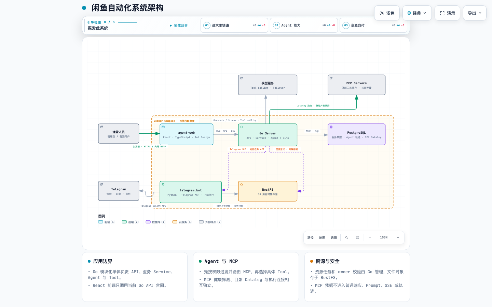

# xianyu.bot

闲鱼运营自动化与可审计 Agent 平台，采用 Go 模块化单体、React 管理控制台和 PostgreSQL。系统覆盖闲鱼商品与消息自动化、Agent 会话与审批、MCP 工具调用，以及 Telegram 资源检索和文件交付。

## 架构



[打开可交互架构图](docs/architecture-overview.html) · [查看架构说明](docs/architecture.md)

主要组件：

- `server/`：Go API、闲鱼业务 Service、Agent/Eino、MCP Catalog 与运行时、PostgreSQL 访问。
- `agent-web/`：React 19、TypeScript、Vite 和 Ant Design 前端，挂载在 `/agent/`。
- `telegram.bot/`：Telegram 会话、Telegram MCP、资源下载执行器。
- PostgreSQL：业务、Agent 轨迹及 MCP 工具目录持久化。
- RustFS：S3 兼容的资源对象存储。

Agent 在权限、启停和 allow/deny 规则过滤后进行 MCP 与 Tool 两级路由。Catalog 刷新、健康探测和执行连接相互独立；执行客户端按需连接并发调用，空闲后按 TTL 回收。审批中的 MCP 写操作会校验提议时的目录摘要，避免定义或策略变化后执行旧参数。

## 快速启动

### 前置条件

- Docker Engine / Docker Desktop，包含 Docker Compose v2。
- 可选：Go `1.26.10`、Node.js 20+ 和 npm，用于本机开发和测试。

### 启动完整环境

在仓库根目录执行：

```bash
docker compose up -d --build
docker compose ps
```

Compose 会启动 Web、Go Server、PostgreSQL、RustFS 和 Telegram 服务。首次空库启动时，Go 服务应用数据库初始化基线和未执行的 Goose 增量迁移。

| 服务 | 地址 | 用途 |
| --- | --- | --- |
| Web 控制台 | <http://127.0.0.1:18080/agent/> | 管理与运营界面 |
| Go API | <http://127.0.0.1:18888> | 前端 API 与服务接口 |
| Telegram 服务 | <http://127.0.0.1:18081> | Telegram 资源与 MCP 服务 |
| PostgreSQL | `127.0.0.1:15432` | 业务数据库 |
| RustFS API | <http://127.0.0.1:19000> | S3 兼容对象 API |
| RustFS Console | <http://127.0.0.1:19001> | 对象存储管理界面 |

初始管理员为 `admin / 123456`，首次登录后应立即修改密码。Compose 默认值仅供本机体验，不能直接用于生产环境。

停止服务但保留数据库和对象存储：

```bash
docker compose down
```

删除数据卷会永久清除本地数据库和对象文件；除非明确要重建空环境并已备份，否则不要使用 `docker compose down -v`。

## 配置与部署

仓库根目录的 `.env` 可覆盖 Compose 环境变量。生产部署至少配置：

| 变量 | 说明 |
| --- | --- |
| `POSTGRES_PASSWORD` | PostgreSQL 密码，需与部署环境的备份和恢复流程一起管理 |
| `XIANYU_JWT_SIGNING_KEY` | JWT 签名密钥，使用随机强密钥 |
| `XY_CREDENTIAL_KEY` | 可选的凭据加密密钥；启用凭据加密时必须稳定保存并纳入恢复流程 |
| `RUSTFS_ACCESS_KEY` / `RUSTFS_SECRET_KEY` | RustFS 访问凭据 |

不要提交 `.env`、API Key、MCP Token、Telegram 凭据或生产数据。服务默认面向可信内网，不应直接暴露到公网；公网部署需另行设计入口认证、TLS、限流和网络隔离。

端口可通过 Compose 中对应的 `*_HOST_PORT` 变量调整，例如 `PGSQL_HOST_PORT`、`RUSTFS_API_HOST_PORT` 和 `RUSTFS_CONSOLE_HOST_PORT`。服务内部使用 Compose 网络地址，不要把容器间地址改为宿主机映射地址。

## 本机开发

先启动本机 Go Server 所需的基础服务：

```bash
docker compose up -d postgres rustfs
```

终端一，运行 Go API：

```bash
cd server
go run ./cmd/server -c config.yaml
```

终端二，运行 React 前端：

```bash
cd agent-web
npm ci
npm run dev
```

前端开发地址为 <http://localhost:5174/agent/>，Vite 将 `/api` 请求代理到本机 Go API。若需运行 Telegram 集成或资源下载流程，使用完整 Compose 环境以提供 Telegram 服务和内部网络依赖。

## 常用检查

从仓库根目录运行：

```bash
cd server && go test ./... && go vet ./...
cd ../agent-web && npm run check
cd .. && docker compose config
```

`npm run check` 包含格式检查、ESLint、TypeScript 检查和生产构建。修改 Go 代码后运行 `gofmt` 和受影响测试；修改界面时还应检查关键浏览器交互。

## 数据库

- 空库使用 `server/internal/infra/migrations/init.sql` 初始化基线，随后自动应用 `server/internal/infra/migrations/goose/` 中的增量迁移。
- 已有数据库按 Goose 版本升级；非空但没有 Goose 历史的数据库会停止启动，需要先核对并建立迁移基线。
- 后续表结构变化只新增 Goose 迁移，不修改固定初始化基线。迁移与备份细节见[数据库文档](docs/database.md)。

## 文档

- [交互式系统架构图](docs/architecture-overview.html) · [架构说明](docs/architecture.md)
- [产品定义](docs/product.md) · [项目范围](docs/project-scope.md)
- [数据库与迁移](docs/database.md)
- [前端现状](docs/frontend.md) · [前端开发规范](docs/frontend-development.md)
- [设计规范](docs/design.md) · [第三方许可](docs/third-party-licensing.md)

更多工程文档见[文档索引](docs/README.md)。
