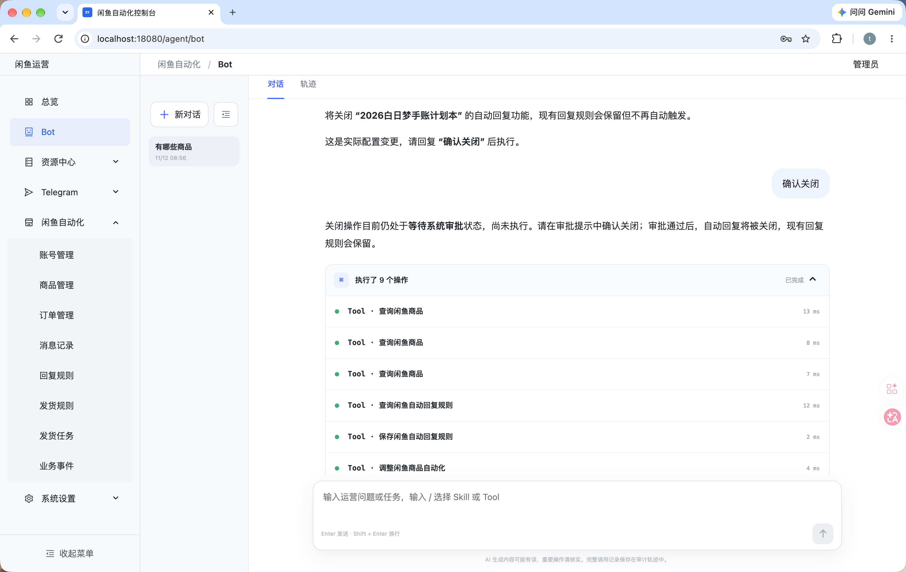
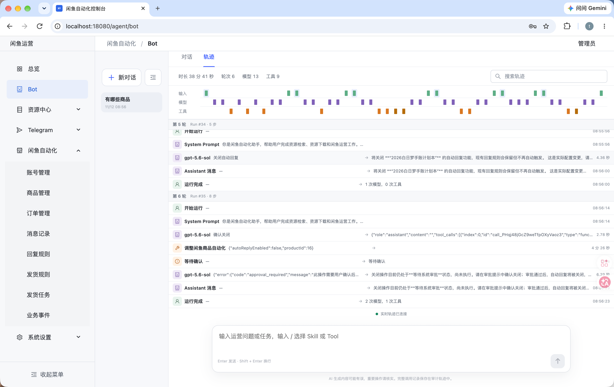

<div align="center">
  
  <p><strong>面向闲鱼运营的可审计 Agent 控制台</strong></p>
  <p>
    
    
    
    
  </p>
  <p>
    
    
    
    
    
  </p>
</div>

xianyu.bot 将闲鱼商品与消息自动化、Agent 会话与审批、MCP 工具调用，以及 Telegram 资源交付集中到一个控制台，让每次自动化操作都可确认、可追踪、可审计。

## 为什么做

闲鱼运营的难点不在某一个操作，而在于账号、商品、消息、订单、规则和资源长期散落在不同工具与脚本中：

- **重复工作多**：查询、回复、发货和续售需要持续投入人工。
- **自动化不透明**：脚本或 AI 做过什么、为何失败、是否越权，很难回看。
- **效率与风险冲突**：完全手工难以扩展，完全自动又可能误改真实业务。
- **资源链路割裂**：资源检索、保存、上架与交付缺少连续工作流。

## 愿景

> 让 Agent 真正参与闲鱼运营，同时始终处于人的控制之下。

xianyu.bot 希望把自然语言任务转化为可执行的运营动作：低风险重复工作交给系统，关键变更交给人确认，所有过程留下可追溯的事实。最终让一个运营人员能够安全地管理更多账号、商品与资源，而不是被更多脚本和后台淹没。

## 如何实现

| 核心能力 | 对愿景的支撑 |
| --- | --- |
| 🤖 **Agent 工作台** | 用对话表达目标，在同一处完成执行、敏感操作确认和轨迹回看 |
| 🛍️ **闲鱼自动化** | 将账号、商品、订单、回复与发货规则收束为可调用的业务能力 |
| 🔌 **MCP 与 Tool** | 通过权限过滤、健康检查和按需调用控制 Agent 的能力边界 |
| 📦 **资源交付** | 串联资源检索、对象存储与 Telegram 文件交付 |

## 界面预览

<a href="docs/agent-approval.png">
  
</a>
<p align="center"><sub>Agent 对话 · 敏感操作需要确认后执行</sub></p>

<a href="docs/agent-trajectory.png">
  
</a>
<p align="center"><sub>执行轨迹 · 模型、工具与审批过程全程可追溯</sub></p>

## Docker Compose

```bash
docker compose up -d --build
```

默认管理员为 `admin / 123456`，首次登录后请立即修改密码。

## License

[Apache License 2.0](LICENSE)
